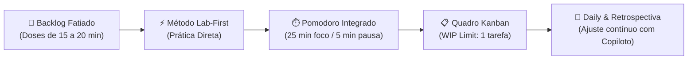

# 🛡️ Darky Cyber: Laboratório Prático de Cibersegurança & Portfólio de Engenharia

```text
                  ___             ___
                /     \         /     \
               |  ()   \       /   ()  |
                \   \   \     /   /   /
       __        \   \   '---'   /   /        __
      /  \________\   \  (o,o)  /   /________/  \
     /             \   \ {___} /   /             \
    |   D A R K Y   \   \ -"- /   /   C Y B E R   |
     \               \   \   /   /               /
      \______/\_______)   \_/   (_______/\______/
                 [ MASCOTE: NYX - A SENTINELA ]
              "Vigilância Silenciosa no Escuro"
```

> **Repositório oficial de formação técnica, experimentação prática e portfólio em Cibersegurança.**  
> Projetado sob a metodologia **Personal Scrum**, abordagem **Lab-First** e acompanhado pelo copiloto de IA **Antigravity**.

---

## 🦉 O Mascote: Nyx, a Coruja Sentinela

A **Coruja** foi escolhida como símbolo supremo do **Darky Cyber** por representar exatamente os três pilares do projeto:

* **Visão 360° (O Analista):** Consegue enxergar ameaças em todas as direções no escuro absoluto, sem deixar passar nenhum pacote ou log anômalo.
* **Voo Silencioso (A Segurança):** Suas asas são projetadas pela natureza para não emitir som — simbolizando o ambiente isolado (*Sandbox*), a discrição e a proteção contra ataques.
* **Ataque Cirúrgico (O Executor):** Paciente na observação, mas rápida e certeira na hora de neutralizar a ameaça.

---

## 📖 Sobre o Projeto

O **Darky Cyber** nasceu para solucionar um dos maiores gargalos na formação de profissionais de segurança da informação: **a lacuna entre a teoria acadêmica e a execução técnica real**. 

Muitos planos de estudo tradicionais falham por excesso de conteúdo passivo (dezenas de horas de vídeo-aulas e apostilas extensas sem aplicação imediata), gerando sobrecarga cognitiva e desmotivação. 

Este projeto adota uma abordagem inversa:
1. **Prática Imediata (*Lab-First*):** O aprendizado é orientado a cenários reais de laboratório, investigação forense, análise de tráfego e testes de vulnerabilidade controlados.
2. **Ambiente 100% Seguro e Isolado (*Sandbox*):** Todos os testes são realizados em máquinas virtuais dedicadas e redes isoladas, garantindo integridade e conformidade com as melhores práticas de segurança da informação.
3. **Construção de Portfólio Técnico:** Cada desafio concluído gera relatórios, scripts de automação e documentação versionada no Git, servindo como comprovação pública de competência técnica para gestores e recrutadores.

---

## ⚙️ A Metodologia de Engenharia

O projeto opera sob o framework ágil **Personal Scrum**, adaptado para o perfil comportamental focado em ação, rigor técnico e comunicação clara:



* **Sprints Semanais (7 dias):** Metas curtas e factíveis, eliminando a ansiedade de planos longos.
* **Tarefas Atômicas:** Nenhuma tarefa ultrapassa 25 minutos (equivalente a 1 ciclo Pomodoro).
* **Work in Progress (WIP Limit = 1):** Foco estrito em uma única atividade por vez para maximizar a qualidade e retenção.
* **Definition of Done (Critério de Conclusão):** O card só é considerado pronto quando o laboratório é resolvido e o relatório técnico é registrado em Markdown.

---

## 🗺️ Arquitetura do Repositório

O repositório está estruturado de forma modular e expansível para refletir padrões de projetos corporativos:

```
c:\dev\darky-cyber\
│
├── 📁 docs/                         # Governança, Metodologia e Planejamento
│   ├── 📄 alinhamento-estrategico.md # Bússola do projeto, perfil e regras antidesistência
│   ├── 📄 metodologia-scrum.md      # Regras ágeis, rituais, papéis e Definition of Done
│   └── 📄 perfil-e-diagnostico.md   # Mapeamento de competências e matriz de habilidades
│
├── 📁 sprints/                      # Ciclos de Execução Técnica (Sprints)
│   └── 📁 sprint-01-linux/          # [Sprint Ativa] Linux Operacional, Comandos & Inspeção
│       ├── 📄 README.md             # Backlog da sprint, comandos essenciais e registro
│       ├── 📁 anotacoes-bandit/     # Write-ups e resoluções dos desafios práticos
│       ├── 📁 cheatsheets/          # Guias rápidos de consulta (linha de comando e atalhos)
│       └── 📁 scripts/              # Automações em Bash para triagem de sistema
│
├── 📁 labs/                         # Laboratórios Locais e Evidências
│   └── (Arquivos de captura .pcap, ambientes locais e configs de virtualização)
│
├── 📁 tools/                        # Ferramentas Visuais Interativas Integradas
│   ├── 📊 kanban.html               # Quadro Kanban ágil com Timer Pomodoro embutido
│   └── 📝 quiz_diagnostico.html     # Aplicação interativa de diagnóstico de segurança
│
├── 📄 README.md                     # Este documento (Visão geral do ecossistema)
└── 📄 .gitignore                    # Regras de segurança (bloqueio de chaves, logs e temporários)
```

---

## 🧭 Trilha de Competências Técnicas (Roadmap Mês 1)

| Ciclo | Pilar Técnico | Foco de Aprendizado | Entregável Prático |
| :---: | :--- | :--- | :--- |
| **Sprint 01** | **Linux Operacional & CLI** | Navegação em terminal, permissões de arquivos, gestão de processos (`ps`/`kill`) e auditoria de portas (`ss`/`netstat`). | Cheatsheet técnico de triagem e resolução de desafios locais. |
| **Sprint 02** | **Redes & Análise de Tráfego** | Inspeção de pacotes com Wireshark, protocolo TCP/IP, 3-way handshake e detecção de tráfego anômalo (DNS Tunneling). | Relatório forense de análise de captura de rede (`.pcap`). |
| **Sprint 03** | **Segurança Web (OWASP)** | Exploração ética e remediação das falhas mais críticas: SQL Injection (SQLi) e Cross-Site Scripting (XSS). | Write-up de exploração controlada e código de correção (*Prepared Statements*). |
| **Sprint 04** | **Consolidação & Portfólio** | Integração dos pilares, simulação de incidente ponta a ponta e publicação do repositório no GitHub. | Repositório público documentado e apresentação do portfólio. |

---

## 🛠️ Ferramentas Interativas Embutidas

Este repositório inclui utilitários visuais próprios desenvolvidos para acelerar a produtividade:

1. **Quadro Kanban Ágil com Pomodoro Integrado:**
   * Localização: [`tools/kanban.html`](file:///c:/dev/darky-cyber/tools/kanban.html)
   * Possui colunas de status (*A Fazer*, *Em Andamento*, *Concluído*), contador de progresso e um **Timer Pomodoro digital** (25 min de foco / 5 min de pausa) com alerta sonoro.
2. **Diagnóstico de Competências Interativo:**
   * Localização: [`tools/quiz_diagnostico.html`](file:///c:/dev/darky-cyber/tools/quiz_diagnostico.html)
   * Avaliação interativa de 10 domínios fundamentais da cibersegurança com geração de relatório em JSON.

---

## ⚡ Status Atual do Projeto

* **Fase:** `Mês 1 - Nivelamento Técnico Prático`
* **Sprint em Execução:** `Sprint 01 - Linux Operacional e Linha de Comando`
* **Ambiente de Trabalho:** Máquina virtual dedicada / WSL2 (ambiente local e isolado).
* **Quadro de Tarefas:** [Acessar Kanban da Sprint 01](file:///c:/dev/darky-cyber/tools/kanban.html)
* **Documentação de Governança:** [Consultar Alinhamento Estratégico](file:///c:/dev/darky-cyber/docs/alinhamento-estrategico.md)

---

## 🔒 Princípios de Segurança & Ética

Todas as atividades desenvolvidas neste repositório seguem rigorosamente as diretrizes de **Hacking Ético** e **Segurança Defensiva**:
* Os testes e explorações são executados exclusivamente em ambientes locais controlados (*sandboxes*) ou plataformas educacionais autorizadas.
* Nenhuma ferramenta ou técnica contida neste projeto é direcionada a redes ou sistemas de terceiros sem autorização prévia e expressa.
