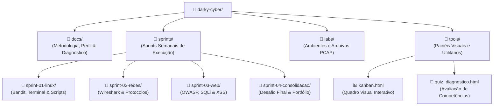

# 🛡️ Darky Cyber: Hub de Carreira & Engenharia de Segurança

> **Repositório oficial de formação prática e portfólio técnico em Cibersegurança.**  
> Estruturado sob metodologia ágil (**Personal Scrum**) e modelo **Lab-First** com acompanhamento do copiloto de IA **Antigravity**.

---

## 🗺️ Mapa da Arquitetura do Repositório

---

## 📂 Estrutura de Pastas Explicada

| Diretório / Arquivo | Descrição e Propósito |
| :--- | :--- |
| [`docs/`](file:///c:/dev/darky-cyber/docs/) | Documentação estratégica, metodologia Personal Scrum e diagnóstico de perfil. |
| ├── [`metodologia-scrum.md`](file:///c:/dev/darky-cyber/docs/metodologia-scrum.md) | Regras das Sprints, Dailies, WIP limits e Critérios de Pronto (*Definition of Done*). |
| └── [`perfil-e-diagnostico.md`](file:///c:/dev/darky-cyber/docs/perfil-e-diagnostico.md) | Mapeamento comportamental (Executor/Comunicador) e matriz de competências. |
| [`sprints/`](file:///c:/dev/darky-cyber/sprints/) | Ciclos de execução semanais focados em entregas práticas. |
| └── [`sprint-01-linux/`](file:///c:/dev/darky-cyber/sprints/sprint-01-linux/) | **[SPRINT ATUAL]** Domínio de Linux CLI, OverTheWire Bandit e automação em Bash. |
| [`labs/`](file:///c:/dev/darky-cyber/labs/) | Espaço reservado para arquivos de captura de rede (`.pcap`), scripts de teste e docker-compose. |
| [`tools/`](file:///c:/dev/darky-cyber/tools/) | Ferramentas visuais interativas geradas para o projeto. |
| ├── [`kanban.html`](file:///c:/dev/darky-cyber/tools/kanban.html) | **Quadro Kanban Visual interativo** para acompanhar suas tarefas da Sprint. |
| └── [`quiz_diagnostico.html`](file:///c:/dev/darky-cyber/tools/quiz_diagnostico.html) | Teste diagnóstico interativo de cibersegurança. |

---

## ⚡ Status da Sprint Atual

* **Sprint Ativa:** `Sprint 01 - Linux Operacional & OverTheWire Bandit`
* **Duração:** 7 dias
* **Objetivo:** Concluir do Nível 0 ao 10 do OverTheWire Bandit e consolidar comandos de inspeção de sistema.
* **Acesso Rápido ao Backlog:** [Ver Backlog da Sprint 01](file:///c:/dev/darky-cyber/sprints/sprint-01-linux/README.md)
* **Quadro Visual da Sprint:** [Abrir Kanban Interativo](file:///c:/dev/darky-cyber/tools/kanban.html)
